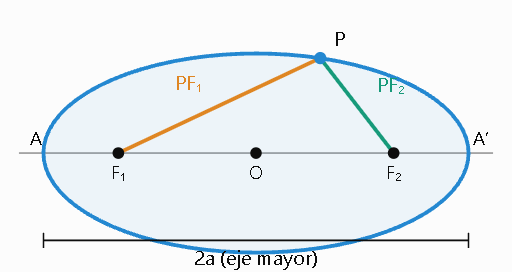

# La elipse
## 1. Definición de la elipse

Una elipse es el lugar geométrico de un punto $P$ que se mueve de manera que la razón entre su distancia a un punto fijo $F$ y su distancia a una recta fija $l$ es constante y menor que 1.

Esta relación se expresa mediante:

$$
 \frac{PF}{PR}=e,\qquad 0<e<1 
$$

Donde:

- $F$: foco de la elipse.
- $l$: directriz.
- $P$: punto de la elipse.
- $e$: excentricidad.
- $PR$: distancia perpendicular desde $P$ hasta la directriz.

## 2. Ecuación ordinaria de la elipse

Para una elipse con centro en el origen y eje mayor horizontal:

$$
 \boxed{\frac{x^2}{a^2}+\frac{y^2}{b^2}=1} 
$$

Donde:

- $a$: semieje mayor.
- $b$: semieje menor.
- $a>b>0$.

La relación entre los semiejes y la excentricidad es:

$$
 b^2=a^2(1-e^2) 
$$

Por tanto:

$$
 e=\frac{\sqrt{a^2-b^2}}{a} 
$$

## 3. Propiedades geométricas

### Elementos principales

| Elemento               | Expresión              |
| ---------------------- | ---------------------- |
| Centro                 | $O=(0,0)$          |
| Vértices               | $(\pm a,0)$        |
| Extremos del eje menor | $(0,\pm b)$        |
| Focos                  | $(\pm ae,0)$       |
| Longitud del eje mayor | $2a$               |
| Longitud del eje menor | $2b$               |
| Distancia focal        | $c=\sqrt{a^2-b^2}$ |
| Excentricidad          | $e=c/a$            |
| Directrices            | $x=\pm a/e$        |
| Ancho focal            | $2b^2/a$           |

### Simetría

La elipse es simétrica respecto de ambos ejes coordenados y respecto de su centro.

### Eje mayor vertical

Cuando el eje mayor coincide con el eje $Y$, la ecuación es:

$$
 \boxed{\frac{x^2}{b^2}+\frac{y^2}{a^2}=1} 
$$

Sus focos son:

$$
 F_1=(0,c),\qquad F_2=(0,-c) 
$$

## 4. Teorema de la suma de los radios focales

La suma de las distancias desde cualquier punto de la elipse hasta sus dos focos es constante e igual a la longitud del eje mayor.

$$
 \boxed{PF_1+PF_2=2a} 
$$

Esta propiedad permite construir geométricamente una elipse utilizando dos puntos fijos y una cuerda de longitud constante.

## 5. Ecuación de una elipse con centro arbitrario 

Si el centro de la elipse se encuentra en $(h,k)$ y sus ejes son paralelos a los coordenados:

$$
 \boxed{\frac{(x-h)^2}{a^2}+\frac{(y-k)^2}{b^2}=1} 
$$

### Forma general

$$
 Ax^2+By^2+Cx+Dy+E=0 
$$

Para $A$ y $B$ positivos, al completar cuadrados se puede determinar si la ecuación representa una elipse real, un punto o una elipse imaginaria.

## 6. Pendiente de la elipse

Para la elipse:

$$
 \frac{x^2}{a^2}+\frac{y^2}{b^2}=1 
$$

La pendiente de la tangente en un punto $P(x_1,y_1)$ es:

$$
 \boxed{m=-\frac{b^2x_1}{a^2y_1}} 
$$

## 7. Ecuación de la tangente 

### Tangente en un punto conocido

La ecuación de la tangente en $P(x_1,y_1)$ es:

$$
 \boxed{\frac{xx_1}{a^2}+\frac{yy_1}{b^2}=1} 
$$

### Tangente con pendiente conocida

Para una pendiente $m$:

$$
 \boxed{y=mx\pm\sqrt{a^2m^2+b^2}} 
$$

### Ecuación de la normal

La normal es perpendicular a la tangente:

$$
 \boxed{y-y_1=\frac{a^2y_1}{b^2x_1}(x-x_1)} 
$$

Esta expresión se aplica cuando $x_1\neq0$.

## 8. Propiedad de la normal

La normal a una elipse en cualquier punto biseca el ángulo formado por los segmentos que unen ese punto con los dos focos.

Esta propiedad explica el comportamiento de reflexión de una elipse: un rayo procedente de uno de los focos se refleja hacia el otro foco.

## 9. Lugar geométrico de los puntos medios de cuerdas paralelas 

Para una familia de cuerdas paralelas de pendiente $m$, los puntos medios pertenecen a una recta que pasa por el centro de la elipse.

Su ecuación es:

$$
 \boxed{y=-\frac{b^2}{a^2m}x} 
$$

Esta recta se denomina diámetro de la elipse asociado a esa familia de cuerdas.

Si un diámetro tiene pendiente $m$, el diámetro que biseca sus cuerdas paralelas tiene pendiente:

$$
 m'=-\frac{b^2}{a^2m} 
$$

## 10. Diámetros conjugados 

Dos diámetros son conjugados cuando cada uno biseca las cuerdas paralelas al otro.

Sus pendientes cumplen:

$$
 \boxed{mm'=-\frac{b^2}{a^2}} 
$$

### Propiedades

- Los diámetros conjugados no son necesariamente perpendiculares.
- Los ejes mayor y menor constituyen un par de diámetros conjugados.
- Las tangentes en los extremos de un diámetro son paralelas al diámetro conjugado.

### Ángulo entre diámetros conjugados

Si dos semidiámetros conjugados tienen longitudes $a'$ y $b'$, y forman un ángulo $\theta$:

$$
 \boxed{\sin\theta=\frac{ab}{a'b'}} 
$$

## 11. Círculos auxiliares

El círculo auxiliar mayor es el círculo que tiene como diámetro el eje mayor de la elipse.

Su ecuación es:

$$
 \boxed{x^2+y^2=a^2} 
$$

El círculo auxiliar menor tiene como diámetro el eje menor:

$$
 \boxed{x^2+y^2=b^2} 
$$

Estos círculos permiten construir y estudiar la elipse mediante relaciones geométricas.

## 12. Ángulo excéntrico 

El ángulo excéntrico $\phi$ permite expresar las coordenadas de un punto de la elipse mediante funciones trigonométricas.

$$
 \boxed{x=a\cos\phi} 
$$

$$
 \boxed{y=b\sin\phi} 
$$

Por tanto, la representación paramétrica es:

$$
 \boxed{P(\phi)=(a\cos\phi,b\sin\phi)} 
$$

Al sustituir:

$$
 \frac{a^2\cos^2\phi}{a^2}+ \frac{b^2\sin^2\phi}{b^2}=1 
$$

Se obtiene:

$$
 \cos^2\phi+\sin^2\phi=1 
$$

Lo que confirma que el punto pertenece a la elipse.

## 13. Formulario de ecuaciones principales

| Concepto                       | Fórmula                                         |
| ------------------------------ | ----------------------------------------------- |
| Elipse horizontal              | $\frac{x^2}{a^2}+\frac{y^2}{b^2}=1$         |
| Elipse vertical                | $\frac{x^2}{b^2}+\frac{y^2}{a^2}=1$         |
| Centro $(h,k)$             | $\frac{(x-h)^2}{a^2}+\frac{(y-k)^2}{b^2}=1$ |
| Relación focal                 | $c^2=a^2-b^2$                               |
| Excentricidad                  | $e=\frac ca$                                |
| Suma de radios focales         | $PF_1+PF_2=2a$                              |
| Ancho focal                    | $L=\frac{2b^2}{a}$                          |
| Pendiente de tangente          | $m=-\frac{b^2x_1}{a^2y_1}$                  |
| Tangente                       | $\frac{xx_1}{a^2}+\frac{yy_1}{b^2}=1$       |
| Diámetros conjugados           | $mm'=-\frac{b^2}{a^2}$                      |
| Coordenada paramétrica $x$ | $x=a\cos\phi$                               |
| Coordenada paramétrica $y$ | $y=b\sin\phi$                               |

# Ejercicios de la elipse

## 1. Ecuación ordinaria de la elipse

Dada la ecuación:

$$
 4x^2+25y^2=100 
$$

Determinar:

- La ecuación en su forma ordinaria.
- El centro y los vértices.
- Los focos y la excentricidad.
- Las directrices y el ancho focal.
- La gráfica de la elipse.

## 2. Elementos de una elipse

Dada la ecuación:

$$
 9x^2+16y^2=144 
$$

Determinar los semiejes, los focos, la excentricidad y las directrices. Representar gráficamente la elipse.

## 3. Ecuación general de una elipse

Dada la ecuación:

$$
 x^2+4y^2-6x-24y+41=0 
$$

Transformarla a su forma ordinaria mediante el método de completar cuadrados. Determinar el centro, los vértices, los focos y la excentricidad.

## 4. Elipse con centro fuera del origen

Determinar la ecuación de una elipse cuyo centro es $(4,3)$, su excentricidad es $\frac12$ y su eje mayor tiene longitud $12$ y es paralelo al eje $X$.

Representar gráficamente la elipse.

## 5. Ecuación de una elipse a partir de sus focos

Determinar la ecuación de una elipse cuyos focos son:

$$
 F_1=(5,-2),\qquad F_2=(-2,-2) 
$$

y cuyo eje mayor tiene longitud $10$.

Determinar también su centro, semiejes y excentricidad.

## 6. Ecuación de una elipse a partir de sus ejes

Determinar la ecuación de una elipse cuyo eje mayor tiene longitud $20$ y cuyo eje menor es igual a la distancia entre sus focos.

Calcular los semiejes y la excentricidad.

## 7. Ecuación de la tangente en un punto

Determinar la ecuación de la recta tangente a la elipse:

$$
 3x^2+8y^2=35 
$$

en el punto:

$$
 P(1,2) 
$$

Comprobar que el punto pertenece a la elipse.

## 8. Tangentes con pendiente conocida

Determinar las ecuaciones de las rectas tangentes a la elipse:

$$
 7x^2+3y^2=28 
$$

que tengan pendiente:

$$
 m=3 
$$

Encontrar las intersecciones de cada tangente con los ejes coordenados.

## 9. Ecuación de la normal

Determinar la ecuación de la recta normal a la elipse:

$$
 x^2+2y^2=50 
$$

que pasa por el punto:

$$
 P(8,12) 
$$

## 10. Diámetros conjugados

Dada la elipse:

$$
 9x^2+16y^2=144 
$$

determinar:

- La ecuación del diámetro que biseca las cuerdas de pendiente $4$.
- La ecuación de la cuerda cuyo punto medio es $(2,-1)$.
- Las ecuaciones de dos diámetros conjugados, uno de los cuales pasa por $(1,2)$.

## 11. Ángulo excéntrico

Encontrar el ángulo excéntrico del punto:

$$
 P(2,\sqrt3) 
$$

que pertenece a la elipse:

$$
 x^2+4y^2=16 
$$

Utilizar las ecuaciones paramétricas:

$$
 x=a\cos\phi 
$$

$$
 y=b\sin\phi 
$$

## 12. Demostración de una propiedad de la elipse

Demostrar que la suma de los cuadrados de los recíprocos de dos diámetros perpendiculares de una elipse es constante.
